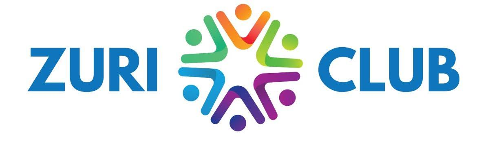

# ZURI Club Website



The public website for the Zetech University Research and Innovation Club (ZURI). It introduces the club, outlines its research and innovation focus, and connects visitors to the club's WhatsApp community.

## Current status

- Responsive, multi-page static website built with HTML, CSS, and JavaScript.
- The home page introduces the club. Separate pages cover club information and leadership, the project directory and 14 project profiles, and the 2025–2026 event archive.
- The club mission, vision, membership overview, and available member support are published from club-supplied information.
- The project showcase contains profiles of 14 club projects based on information supplied by the club, including SmartWaste by Elly Okello.
- Article content has not yet been supplied for publication.
- The events page now includes month-by-month archives for 2025 and 2026. The 2026 summit entry is flagged because its notes give both 12 January and 27–28 January.
- BIT concept illustrations, event photos, and ZURI community photos are used in their related project, event, and home-page sections.
- The WhatsApp invite is `https://chat.whatsapp.com/K7sTw4zHiXr5oTB896LgVl`.
- No backend, database, member accounts, online submission storage, or publishing dashboard is included.
- No development server or deployed website is started by this project automatically.

## Preview locally

No packages or build step are required. From the project folder, either open `index.html` in a browser or run a local static server:

```powershell
py -m http.server 8000
```

Then open [http://localhost:8000](http://localhost:8000). Stop the server with `Ctrl+C` in the terminal where it is running.

The fonts are loaded from Google Fonts when the browser is online. The page uses local system fonts as fallbacks.

## Website structure

The site is static and has no build step. Shared navigation connects these pages:

1. **Home** (`index.html`) - Club introduction, focus areas, featured projects, and community links.
2. **About** (`about.html`) - Mission, vision, membership, resources, and leadership profiles.
3. **Projects** (`projects.html`) - Portfolio directory linking to one page per project in `projects/`.
4. **Events** (`events.html`) - Month-by-month archives of the 2025 and 2026 activities supplied by the club, with related event photos.
5. **Insights** - The article introduction on the home page, ready for reviewed articles.

The project pages give each team room for a full description, approach, impact, and team list. Add project images when the club provides them. A CMS is only needed if committee members must publish without editing website files. A custom backend is only needed for features such as accounts, private information, or submissions stored by the site.

## Project files

```text
index.html              Page content, navigation, links, and metadata
about.html              Club mission, vision, membership, resources, and leadership
projects.html           Project portfolio directory
projects/               Individual static project profiles
events.html             2025 and 2026 event archives and photos
styles.css              Colors, typography, layout, responsive rules, and focus styles
script.js               Mobile menu behavior and automatic footer year
public/images/hero.jpg  Zetech campus image used in the home hero
public/images/zetech-logo.jpg  Zetech University mark
public/images/zuri-logo.jpg    ZURI Club logo
public/images/patron.png
public/images/chairperson.png
public/images/interim-chairperson.png
public/images/vice-chairperson.png
public/images/programme-coordinator.png
public/images/communication-director.png
public/images/membership-chair.png  Leadership profile photos
public/images/BIT*.png             BIT project concept illustrations
public/images/*Summit*.png         2026 summit photos
public/images/Innovation Day*.jpg  2025 Innovation Day photos
public/images/Design Thinking*.jpg 2025 hackathon photo
public/images/*Community*.jpg      ZURI community photos
public/images/AI and Machine Learning Camp 2025.jpg  Community learning photo
README.md               Project guide and content update notes
```

## Leadership profiles

- Md. Esther Mwangi - Patron
- Moses Tabalya - Chairperson
- Elly Okello - Interim Chairperson
- Paul Wako - Vice Chairperson
- Ivy Nganga - Programme Coordinator
- Gabriel Nyaringo - Communication Director
- Emmanuel Bett - Membership Chair

## Interactions

- Header navigation links to the site pages and relevant home-page sections.
- The mobile menu opens and closes with its button. It also closes after a link is selected, when the user clicks outside it, when Escape is pressed, or when the screen expands to desktop width.
- The join, project sharing, and opportunity links open the WhatsApp invite in a new tab.
- The footer year updates automatically.
- Event archive months expand and collapse using native page controls.
- The site includes a skip link, semantic section headings, keyboard focus indicators, and reduced-motion support.

## Updating content

1. Confirm project descriptions, team membership, and current progress with project teams; confirm event dates and registration links with event owners; confirm article text with its author.
2. Confirm leadership names and roles with the club before changing the profiles. Photos are stored in `public/images/` with role-based filenames.
3. Edit the relevant page. Project descriptions and teams are in separate files under `projects/`; add the corresponding card and detail link in `projects.html` when adding a project. Add project images to the related profile gallery with descriptive alt text.
4. Add events to the matching year and month in `events.html`; place event photos in the photo gallery with captions that identify the event.
5. Keep navigation links and page paths in sync. Check that each link points to an existing page or section.
6. If the WhatsApp invite changes, replace it across the site pages.
7. Replace the relative `og:image` path with an absolute public image URL when the hosting address is known.

The current project sharing and opportunity buttons open the general WhatsApp group. They do not collect or store submissions separately.

## Before launch

- Confirm the official club description, membership process, contact method, and all published information.
- Confirm approval to publish the university and club marks, photographs, and member details.
- Choose the hosting account owner and approved domain.
- Set an absolute social sharing image URL and check the page title and description after deployment.
- Agree who reviews and publishes future content updates.

The site can be hosted on GitHub Pages, Vercel, or another static host. Hosting and a custom domain are not configured by this project.
